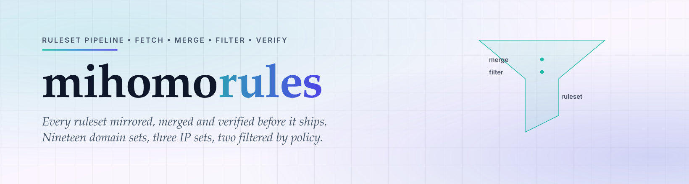

<div align="center">

<a href="https://github.com/CauriumX/mihomo-rules">
  <picture>
    <source media="(prefers-color-scheme: dark)" srcset="assets/hero-dark.svg">
    
  </picture>
</a>

</div>

<div align="center">

[][ci]
[][tags]
[][osi]

</div>

<h1 align="center">mihomo-rules</h1>

<div align="center">

> Ruleset pipeline: fetch, merge, filter, verify.

</div>

> [!NOTE]
> The badge row above is static SVG, not a live service query. A build pipeline
> whose own status badge depends on a third party is not self-hosted, whatever
> its rulesets say.

<div align="center">

English | [简体中文](README.zh-CN.md)

</div>

---

## Why

A routing config that points at third-party ruleset hosts inherits their
availability, their censorship decisions, and their silent changes. When one of
those hosts goes offline or reshuffles its lists, every client breaks, and
nothing tells you it happened.

This pipeline mirrors every ruleset it uses, merges multi-source sets under a
declared policy, filters out entries that do not belong, and reports every
change before it is applied.

## What

A build pipeline and the artefacts it produces:

- **19 domain rulesets** and **3 IP rulesets**, built from 29 upstream files
- **Multi-source merges** — AD-Site unions two upstreams (316,103 entries);
  AI-Site merges then drops 15 generic SaaS dependencies (222 entries)
- **A build script** that fetches, converts, filters, and diffs against the
  committed artefacts
- **Verification tooling** — 51 unit tests, ruleset-overlap contracts,
  doc-reference assertions

Upstream addresses are injected through environment variables and never
committed. Raw snapshots live in a separate private repository.

## Structure

```
build-rules.sh            build pipeline (fetch, convert, filter, diff)
ruleset/
  site/*.mrs              19 domain rulesets
  geoip/*.mrs             3 IP rulesets
  Crypto.mrs              crypto and exchange
  PayPal.txt              official domains
  PayPal-Phish.txt        phishing domains
  SOURCES.md              provenance register
  precedence.yaml         priority and overlap declarations
filters/                  keep and drop lists
tools/                    verification and build helpers
docs/                     architecture notes
```

## Quick start

```sh
# 1. Configure upstream addresses (never committed)
cp .env.example .env.local
# edit .env.local with the real upstream URLs

# 2. Check for upstream changes without touching the working tree
set -a && . ./.env.local && set +a
bash build-rules.sh check

# 3. Apply once the change report looks right
bash build-rules.sh apply
```

Build a single category, or build from a snapshot instead of the network:

```sh
bash build-rules.sh site     # domain rulesets
bash build-rules.sh geoip    # IP rulesets
SNAPSHOT_DIR=/path/to/snapshot bash build-rules.sh check
```

## Design rules

Each of these exists because breaking it caused a silent failure at some point.

**Upstream addresses are environment variables, never defaults.** A default
value that embeds a real host turns a missing variable into a working build
against the wrong source.

**A change over 30% blocks the build.** `riskgrade` reports `BLOCK` and refuses
to apply without confirmation. A ruleset that suddenly doubles is either an
upstream mistake or a poisoned list; neither should ship unattended.

**Ruleset artefacts are committed.** The release repository references them by
URL. Ignoring them would 404 every provider in the subscription.

**`mrs` does not carry `DOMAIN-KEYWORD`.** mihomo treats the whole line as a
literal domain. Keyword rules are stripped before conversion and inlined in the
template instead.

## Adopting

A new ruleset must be registered in `ruleset/SOURCES.md` with its provenance and
overlap rate before it can be merged. Every overlap between two rulesets must be
declared in `ruleset/precedence.yaml`; an undeclared overlap fails the build
rather than silently shadowing.

Verify before pushing:

```sh
npm test
npm run check:refs
python3 tools/check-overlap.py
```

## Feedback

Issues and PRs are welcome. For a ruleset that misfires, include the domain, the
group it landed in, and the group you expected — a diff of the two is usually
enough to locate the rule.

## License

MIT © CauriumX

[ci]: https://github.com/CauriumX/mihomo-rules/actions
[tags]: https://github.com/CauriumX/mihomo-apply/tags
[osi]: https://opensource.org/licenses/MIT