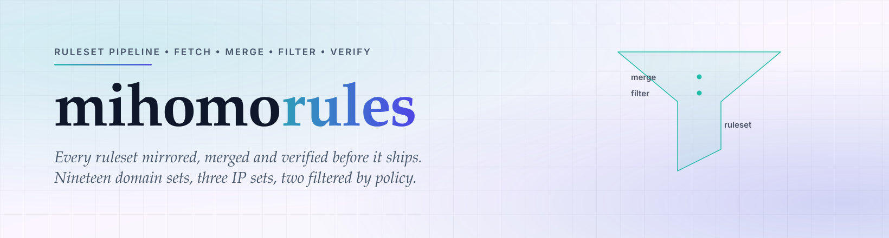

<div align="center">

<a href="https://github.com/CauriumX/mihomo-rules">
  <picture>
    <source media="(prefers-color-scheme: dark)" srcset="assets/hero-dark.svg">
    
  </picture>
</a>

</div>

<div align="center">

[][ci]
[][tags]
[][osi]

</div>

<h1 align="center">mihomo-rules</h1>

<div align="center">

> 规则集流水线：拉取、合并、筛选、校验。

</div>

> [!NOTE]
> 上面的徽章是静态 SVG，不是实时服务查询。一个自身状态都要依赖第三方的构建流水线，
> 无论它的规则集怎么说，都不算自托管。

<div align="center">

[English](README.md) | 简体中文

</div>

---

## 为什么

分流配置如果直接指向第三方规则集托管方，就等于继承了它们的可用性、它们的审查决定，以及它们不声不响的改动。任何一个下线或重排列表，所有客户端一起失效 —— 而配置本身不会告诉你发生了什么。

本流水线把它用到的每份规则集镜像下来，按声明的策略合并多源规则集，剔除不属于该分类的条目，并在应用前报告每一处改动。

## 是什么

一套构建流水线，以及它产出的产物：

- **19 个域名规则集** 与 **3 个 IP 规则集**，由 29 个上游文件构建
- **多源合并** —— AD-Site 合并两个上游（316,103 条）；AI-Site 合并后剔除 15 条通用 SaaS 依赖（222 条）
- **构建脚本** —— 拉取、转换、筛选，并与已提交的产物比对
- **校验工具** —— 51 项单元测试、规则集重叠契约、文档源码引用断言

上游地址通过环境变量注入，从不提交。原始快照存在独立的私有仓库。

## 目录

```
build-rules.sh            构建流水线（拉取、转换、筛选、比对）
ruleset/
  site/*.mrs              19 个域名规则集
  geoip/*.mrs             3 个 IP 规则集
  Crypto.mrs              加密与交易所
  PayPal.txt              官方域名
  PayPal-Phish.txt        钓鱼域名
  SOURCES.md              来源登记
  precedence.yaml         优先级与重叠声明
filters/                  保留与剔除清单
tools/                    校验与构建工具
docs/                     架构文档
```

## 快速开始

```sh
# 1. 配置上游地址（不会提交）
cp .env.example .env.local
# 编辑 .env.local，填入真实上游地址

# 2. 检查上游是否有变更，不修改工作区
set -a && . ./.env.local && set +a
bash build-rules.sh check

# 3. 变更报告确认无误后应用
bash build-rules.sh apply
```

只构建某一类，或从快照构建而不访问网络：

```sh
bash build-rules.sh site     # 域名规则集
bash build-rules.sh geoip    # IP 规则集
SNAPSHOT_DIR=/path/to/snapshot bash build-rules.sh check
```

## 设计约束

下面每一条都存在，因为破坏它曾经导致过静默失效。

**上游地址是环境变量，永远不是默认值。** 一个内嵌真实地址的默认值，会把「变量没设」变成「构建成功但源错了」。

**变化超过 30% 阻断构建。** `riskgrade` 报告 `BLOCK`，未经确认拒绝应用。一个规则集体量突然翻倍，要么是上游出错，要么是被投毒，都不该无人值守上线。

**规则集产物必须入库。** 发布仓通过 URL 引用它们，忽略会让订阅里的每个 provider 全部 404。

**`mrs` 不承载 `DOMAIN-KEYWORD`。** mihomo 把整行当字面量域名。关键词规则在转换前被剥离，改为内联在模板里。

## 采纳

新增规则集必须在 `ruleset/SOURCES.md` 登记来源与交集率之后才能合并。两个规则集之间的任何重叠都必须在 `ruleset/precedence.yaml` 声明；未声明的重叠会让构建失败，而不是静默遮蔽。

推送前校验：

```sh
npm test
npm run check:refs
python3 tools/check-overlap.py
```

## 反馈

欢迎 issue 与 PR。如果某条规则集误伤，请附上域名、它落到了哪个组、你期望它落到哪个组 —— 两者的差异通常足以定位到具体规则。

## License

MIT © CauriumX

[ci]: https://github.com/CauriumX/mihomo-rules/actions
[tags]: https://github.com/CauriumX/mihomo-apply/tags
[osi]: https://opensource.org/licenses/MIT